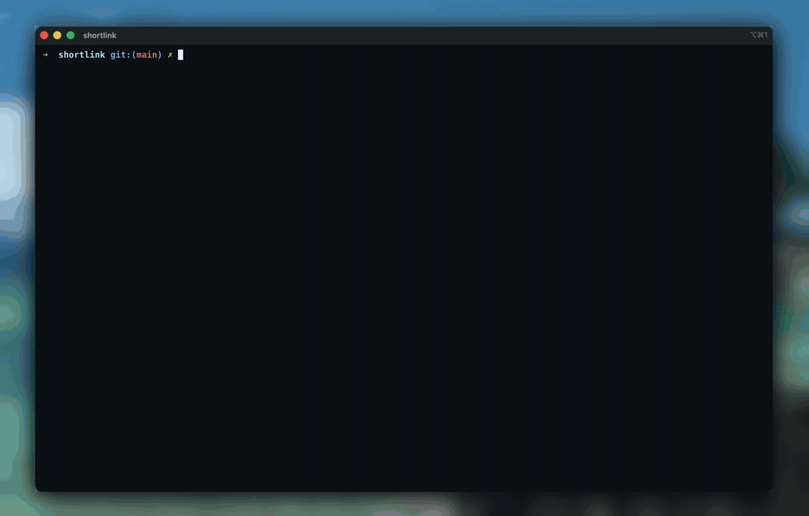
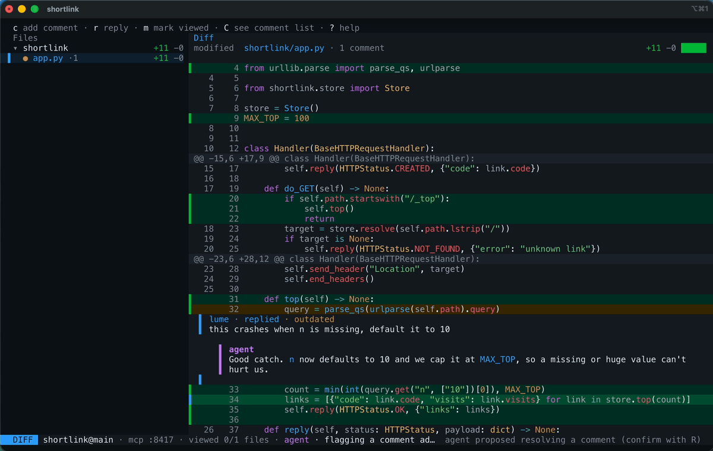
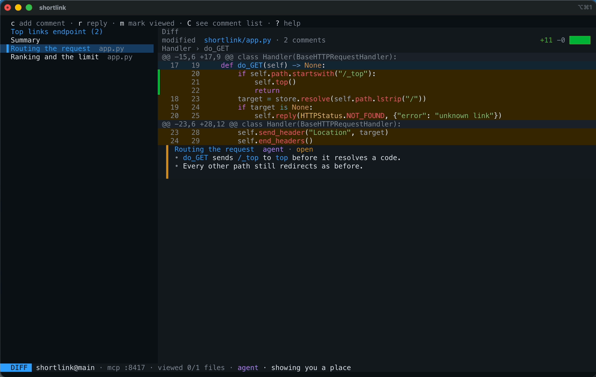
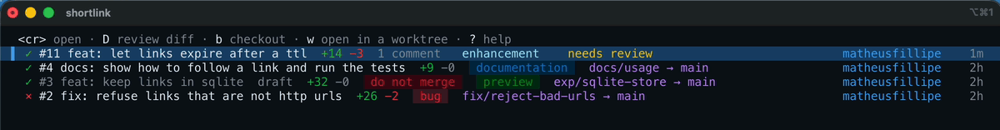
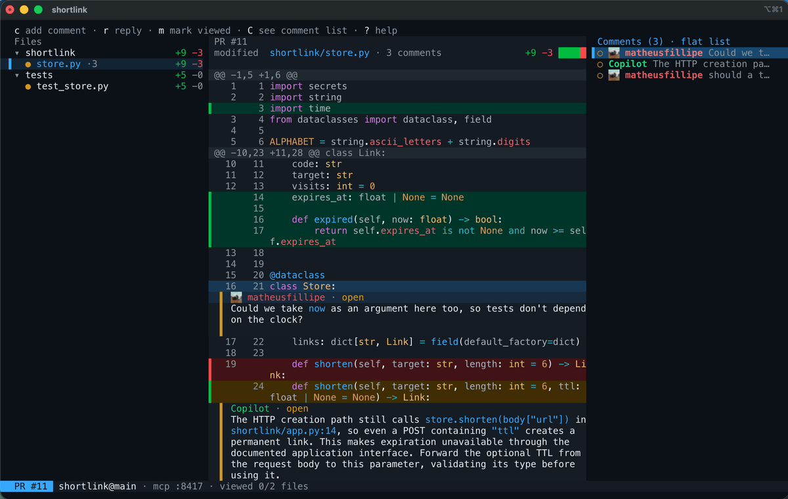
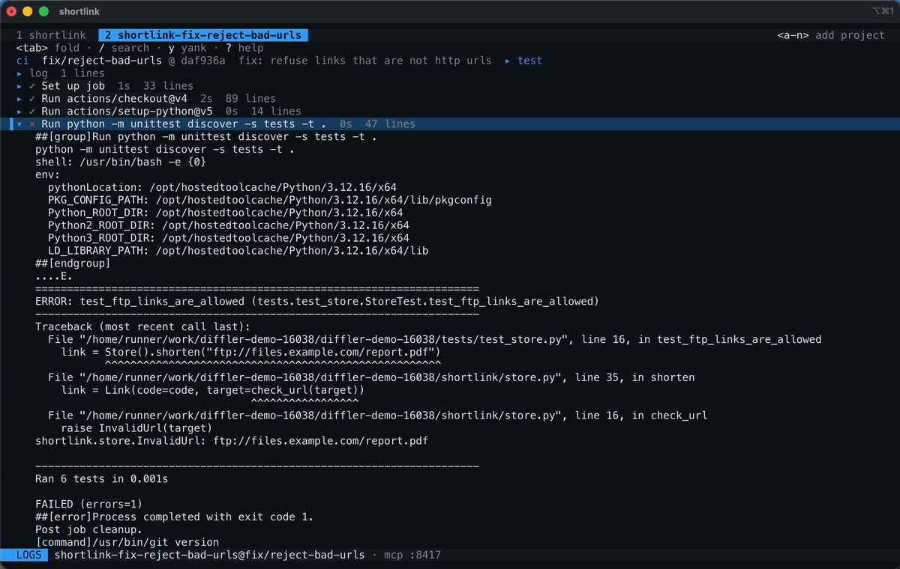
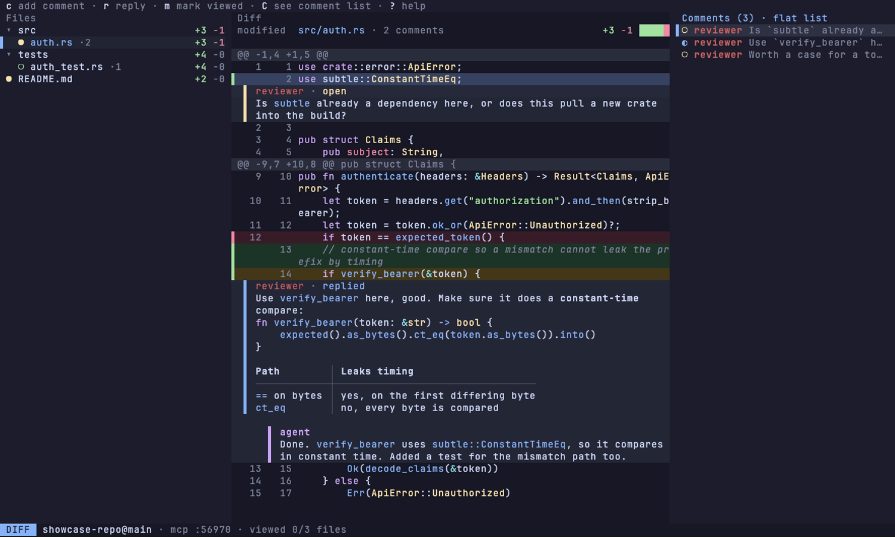

<h1 align="center">diffler</h1>

<p align="center">
<b>magit, without Emacs, built for working with coding agents.</b><br>
A terminal git UI where you stage and commit, review pull requests and their CI,<br>
and leave comments in the diff that your agent answers and fixes.
</p>

<p align="center">
<a href="#install">Install</a> ·
<a href="#quick-start">Quick start</a> ·
<a href="#with-a-coding-agent">Agents</a> ·
<a href="#keys">Keys</a> ·
<a href="#faq">FAQ</a> ·
<a href="https://chat.h4ks.com">IRC</a>
</p>



I love magit and wanted it as its own program, with the vim-style keys it has
in [Doom Emacs](https://github.com/doomemacs/doomemacs). Then coding agents
came along, and reading what they write became a big part of the day. So in
diffler you comment right in the diff, and your agent replies in the thread
and fixes the code while you watch.

## What it does

### Your agent answers your comments

Press <kbd>c</kbd> on any line to leave a comment, or select a few lines with
<kbd>V</kbd> first to comment on all of them. Your agent replies in each thread
and fixes the code, and the diff updates while you watch.



### It walks you through its change

Your agent can publish a walkthrough of what it changed: one stop per decision,
each pointing at the code it is about, and open it in diffler. It can also take
you straight to any file, line or pull request.



### Pull requests without the browser

<kbd>b</kbd> <kbd>p</kbd> lists the open pull requests with their CI, review
state and labels, on GitHub, GitLab and Forgejo. Open one to read its
conversation, review the diff and submit your review. <kbd>C</kbd> lists every
comment on the side, and <kbd>R</kbd> requests a reviewer, Copilot included.





### CI logs, down to the failing step

<kbd>o</kbd> lists the CI runs of your branch. Open a run, then the step that
failed, to read its log. Press <kbd>w</kbd> on a pull request to check it out
in its own worktree, and it opens as a new tab next to your project.



### And more

- Stage files, hunks or single lines, commit, amend, branch, stash, push and
  pull, all from the keyboard.
- Comment on any file of the repo, too.
- Press <kbd>y</kbd> to copy what you selected with <kbd>V</kbd>, or a file's
  comments as markdown to paste into any agent. On a pull request it copies the
  URL.
- Open your repos and worktrees as tabs and switch between them with one key.
- Step back through a file's history and see who changed each line.
- It works in git and jj repos.
- It shows images right in the terminal, over
  [kitty, sixel or iTerm2](https://github.com/benjajaja/ratatui-image).

## Install

<details>
<summary><b>macOS</b></summary>

```sh
brew tap matheusfillipe/diffler https://github.com/matheusfillipe/diffler
brew install diffler
```

</details>

<details>
<summary><b>Windows</b></summary>

```sh
winget install matheusfillipe.diffler
```

Or with Scoop:

```sh
scoop bucket add diffler https://github.com/matheusfillipe/diffler
scoop install diffler
```

</details>

<details>
<summary><b>Arch Linux</b></summary>

```sh
yay -S diffler-bin
```

</details>

<details>
<summary><b>Nix</b></summary>

```sh
nix profile install github:matheusfillipe/diffler
```

</details>

<details>
<summary><b>Cargo</b></summary>

```sh
cargo install diffler
```

</details>

<details>
<summary><b>npm</b></summary>

```sh
npm install -g @mattfillipe/diffler
```

</details>

Prebuilt binaries for Linux, macOS and Windows, on x86_64 and arm64, are on the
[releases page](https://github.com/matheusfillipe/diffler/releases).

## Quick start

Run `diffler` in any git repo.

- <kbd>Enter</kbd> opens the file, diff or pull request under the cursor
- <kbd>s</kbd> stages, <kbd>c</kbd> <kbd>c</kbd> commits
- <kbd>c</kbd> comments on the line
- <kbd>e</kbd> opens the file in your editor
- <kbd>Ctrl</kbd>+<kbd>k</kbd> finds any command, <kbd>?</kbd> shows every key

### With a coding agent

Connect your agent once:

<details>
<summary><b>Claude Code</b></summary>

```sh
claude plugin marketplace add matheusfillipe/diffler
claude plugin install diffler@diffler
```

This also adds `/df` to answer your comments, `/dfa` for a walkthrough of a
change, and `/dfr` to review one.

</details>

<details>
<summary><b>opencode</b></summary>

Add the server to `opencode.json` in the project, or globally in
`~/.config/opencode/opencode.json`:

```json
{
  "mcp": {
    "diffler": {
      "type": "local",
      "command": ["npx", "-y", "diffler-mcp"],
      "enabled": true
    }
  }
}
```

Then install the `/df`, `/dfa` and `/dfr` commands:

```sh
mkdir -p ~/.config/opencode/commands
for c in df dfa dfr; do curl -fsSLo ~/.config/opencode/commands/$c.md \
  https://raw.githubusercontent.com/matheusfillipe/diffler/main/.opencode/commands/$c.md; done
```

</details>

<details>
<summary><b>Any other MCP agent</b></summary>

Run `npx -y diffler-mcp` as a stdio server. It connects to the diffler running
in your repo. A client that speaks streamable HTTP can also connect to
`http://127.0.0.1:8417/mcp`, where the first diffler you start listens.

</details>

Then ask your agent to answer your comments (`/df` in Claude Code and opencode).
It replies in each thread and fixes the code. Its tools are in
[docs/mcp.md](docs/mcp.md), and `diffler --no-mcp` turns the connection off.

## FAQ

**Do I need a coding agent to use diffler?**\
No. It is a full git UI by itself. `diffler --no-mcp` turns the agent
connection off.

**Does it send my code or usage data anywhere?**\
No. diffler has no telemetry. It talks to GitHub, GitLab or Forgejo only when
you open their pull requests or CI, with the credentials you already set up
for `gh`, `glab` or Forgejo.

**Who can reach the agent connection?**\
Only programs on your machine. The MCP server listens on `127.0.0.1`.

**Can an agent post on my pull request?**\
No. What an agent writes stays in diffler on your machine. Only comments and
replies under your name go to the forge, and only when you submit the review
yourself.

**Is it safe to let an agent read review comments?**\
Other people write the comments on a pull request, and your agent reads them
as plain text. diffler passes them on unchanged, so treat them like any text
from the internet when you decide what your agent may do.

## Keys

You move like in vim: `j`/`k`, `gg`/`G`, `/` to search, Ctrl+d/Ctrl+u to scroll.

| Key | What it does |
| --- | --- |
| Enter | Open what's under the cursor |
| `s` / `u` | Stage / unstage a file, a hunk, or the lines you selected with `V` |
| `cc` | Commit |
| `c` | Comment on the line, or on a range you selected with `V`, in a diff or any file |
| `m` | Mark the file as viewed |
| `t` | Change how the file list is grouped |
| `\|` | Switch between a unified and a side-by-side diff |
| `]` / `[` | Jump to the next / previous hunk |
| `za` / Tab | Fold or unfold a hunk, or the earlier replies of a thread |
| `*` / `#` | Find where the symbol on the line is used |
| `d` | Review against another branch or commit |
| `C` | Open the list of comments |
| `gf` | Open any file in the repo |
| Alt+n | Open another project as a tab, then Alt+h / Alt+l to switch |
| `w` | Open, create or remove a worktree |
| `y` / `Y` | Copy your selection or this file's comments / all comments, to paste into any agent |
| `gy` / `gx` | Copy / open the GitHub, GitLab or Forgejo link to the line |
| `B` | See who last changed each line |
| `{` / `}` | Step to the file's older / newer version |
| `e` | Open the file in your editor |
| `q` | Go back, or quit |

The mouse works too: right-click anything for a menu. You can remap every key in
[docs/config.example.toml](docs/config.example.toml).

## Configuration

diffler reads `~/.config/diffler/config.toml`, then `.diffler/config.toml` in
the repo, then the command line flags, and the later ones win.
[docs/config.example.toml](docs/config.example.toml) lists every option. To see
the merged result and where each value came from, run:

```sh
diffler config --dump
```

## Themes

Press `T` to switch themes live, or set `ui.theme`. The
[gallery](showcase/THEMES.md) shows all of them. To make your own, put a TOML
file in `~/.config/diffler/themes/`, and [docs/themes](docs/themes/README.md)
lists every key you can set.



## Similar projects and inspiration

- [magit](https://magit.vc) and [neogit](https://github.com/NeogitOrg/neogit)
- [lazygit](https://github.com/jesseduffield/lazygit)
- [gitui](https://github.com/gitui-org/gitui)
- [gitu](https://github.com/altsem/gitu)
- [tuicr](https://github.com/agavra/tuicr)
- [jjui](https://github.com/idursun/jjui)

## Development

```sh
just ci     # fmt + clippy + tests
just e2e    # PTY end-to-end suite (needs uv)
```

You need Rust 1.90 or newer, `just` and `cargo-nextest`. Run `prek install` once
to set up the git hooks. [CONTRIBUTING.md](CONTRIBUTING.md) has the rest.

## License

MIT or Apache-2.0, at your option.
